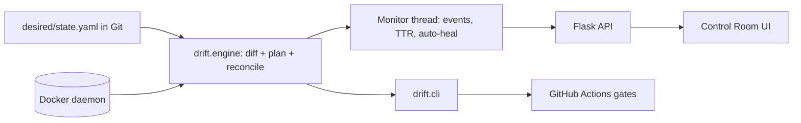

# Drift Control Room: Infrastructure Drift Detection & Reconciliation

Infrastructure is declared in Git (`desired/state.yaml`). People change running systems by hand
(a stopped service, a changed port, a debug flag). This project **detects that drift, shows it, and restores
the system to the state in Git**, with a live dashboard, a CLI, and a CI gate.

## Run it (one command)

```bash
docker compose up --build        # then open http://localhost:5000
```
Needs Docker only. The dashboard bootstraps the stack from Git: `web` (nginx, :8081), `cache` (redis) and
`shop-api` (the example app, :8082). Terminal-only version: `pip install -r requirements.txt && ./scripts/demo.sh`.

## The example application: why it makes the demo land

`shop-api` renders its own config. When someone sets `APP_ENV=debug` by hand, the live preview in the dashboard
flips from a **green "PRODUCTION"** banner to a **red "DEBUG MODE: stack traces exposed"** banner. Drift stops being an
abstract diff and becomes a visible security problem, and reconciling turns it green again.

## 5-minute demo script

1. Show `desired/state.yaml` (and `git log`) next to the dashboard: three green cards.
2. **Inject drift:** `shop-api` → Edit env → `APP_ENV=debug`; `web` → Stop. Cards turn red, the live app banner turns red.
3. **Diff viewer:** Desired (green) vs Actual (red), side by side.
4. **Plan** (dry run, nothing touched), then **Reconcile**: cards go green, timeline shows *time to recovery*.
5. Enable **Auto-heal**, inject again, and watch it fix itself within one poll interval.
6. **GitOps direction:** edit `FEATURE_NEW_CHECKOUT: "on"` in `state.yaml` → the dashboard flags drift the other way (Git moved first) → Reconcile rolls the change out.
7. Download the **Markdown/JSON report**; show the **GitHub Actions** run and its `drift-report` artifact.

## Architecture



| Layer | Choice | Role |
|---|---|---|
| Engine | Python + Docker SDK (`drift/engine.py`) | One implementation shared by CLI, CI and API |
| Monitor | thread + event log (`drift/monitor.py`) | Detection, timeline, time-to-recovery, auto-heal |
| API | Flask: `/status /diff /plan /reconcile /inject /autoheal /report /git /ci` | Engine ↔ UI |
| Frontend | Jinja + JS + Tailwind | Dashboard with 2s polling |
| Packaging | Docker Compose | One-command demo |
| Automation | GitHub Actions | Unit tests, drift self-test gates, report artifact |

## Design decisions worth explaining

- **Label-scoped ownership.** Only containers labelled `drift.managed=true` are ever read or modified; anything else on the host is untouched (tested).
- **Env comparison ignores image-baked variables**, so only human-set values count as drift; undeclared extra vars are drift too.
- **Minimal fix.** A stopped container is *started*; port/env/image drift means *recreate* (Docker cannot change those in place).
- **Desired state is re-read every poll**, so a commit is picked up live.
- **Tested without Docker.** `tests/fakes.py` is an in-memory Docker stand-in, so 13 tests cover detect/plan/fix/auto-heal/API in under a second.

## Honest limitations

- **Docker socket mount is root-equivalent on the host** (deliberate, for the demo). Production would use a socket proxy with an allow-list, or a remote daemon with TLS, plus auth on the dashboard.
- Polling, not Docker events. Simple and robust; event-driven detection would cut latency.
- Scope is single-host containers. Volumes, networks and multi-host orchestration are out of scope (next step: Kubernetes objects via the same diff/plan/apply shape).
- CI runs a **self-test** (converge, inject, assert detection, recover) on a fresh runner; it demonstrates the gate, but a scheduled check against real infrastructure needs `DOCKER_HOST` pointing at it.
